## Layout for [BastardKB](https://bastardkb.com) boards (and other 3x5+2)

The layout has coverage of near 100% of all the keys present on a standard 100% ANSI keyboard in the span of 6 layers and 4 thumb keys - the main exceptions being AltGr, RCtrl, RGui - without using Layer Taps or Mod Taps except on the NumPad Layer. This is done by using Tri Layers and thumb combos.

The base layer is [Aptmak](https://github.com/Apsu/aptmak), with V, Q, and Z, on combos as an adaptation to allow support on 30 key (23332) layouts like [Hummingbird](https://github.com/PJE66/hummingbird), [Batreeq](https://github.com/AlaaSaadAbdo/battoota#batreeq), [Rommana](https://github.com/AlaaSaadAbdo/Rommana), or [Luna](https://github.com/mindhatch/keyboards#%E3%83%AB%E3%83%8A-luna), with minimal modifications.

## Keymap (generated with Caksoylar's [keymap-drawer](https://github.com/caksoylar/keymap-drawer))

### [34 key (3x5+2)](./assets/split34_keymap_zmk.yaml)


### [30 key (23332+2)](./assets/split30_keymap.yaml)


## Skeletyl (v3.2, Kinesis Advantage aligned)



Design rules: thumbs carry whitespace and layers (no layer-taps on letters),
every unshifted symbol stays on the same finger as on a Kinesis Advantage,
shifted numbers sit directly above their digits, and brackets/quotes are
mirrored two-finger combos.

| Thumb (outer → inner) | Left | Right (inner → outer) |
|---|---|---|
| tap | Bspc · Cmd · Esc | Tab · Enter · Space |
| hold | – · – · Symbols | Symbols · Function · – |

Combos (same row, adjacent fingers, Base layer only, 40 ms), placed where the
Kinesis Advantage has the key. As on a Kinesis, Shift is always held on the
**opposite** hand:

| Combo | Output | + opposite Shift | Kinesis position |
|---|---|---|---|
| `Q+W` | `=` | hold `;` → `+` | top-left corner |
| `Z+X` | `` ` `` | hold `;` → `~` | bottom-left corner |
| `I+O` | `-` | hold `A` → `_` | top-right row (Kinesis `-` is right of `0`) |
| `O+P` | `\` | hold `A` → `\|` | right of P |
| `L+;` | `'` | hold `A` → `"` | right of `;` |
| `,+.` | `[` | hold `A` → `{` | bottom-right row |
| `.+/` | `]` | hold `A` → `}` | bottom-right row |

Home-row mods are positional: a mod key only becomes Shift/Ctrl/Cmd/Alt when
the next key is on the other hand or a thumb (`hold-trigger-key-positions`).
Same-hand rolls always type letters. For a same-hand shortcut, hold the mod
past 200 ms first.

`I+O` uses a 25 ms window instead of 40 ms so fast rolls through `io` (function, action) stay letters; press I and O together deliberately.

`O+P` and `.+/` have a 150 ms prior-idle guard because `op` (stop, open) and
`./` (relative paths) are typed mid-word; they only fire after a short pause.

`€` is Function + D and assumes the macOS US layout (Option+Shift+2).

Space on the Base layer is `&sentence_space` from
[zmk-sentence-case](https://github.com/rafaelromao/zmk-sentence-case): after
`.`, `!` or `?` the next letter is capitalised automatically (within 2 s of the
punctuation and 1 s of the space). Space on the other layers is a plain space.
The module is pinned by commit in `config/west.yml`.

Printable one-page version: [assets/skeletyl_v2_keymap.pdf](./assets/skeletyl_v2_keymap.pdf) (A4).

Regenerate all diagrams (SVG, PNG, printable PDF) after any keymap change:

```sh
scripts/draw_keymap.sh
```

Agents working in this repo must do this on every layout change; see [AGENTS.md](./AGENTS.md).

### ZMK Studio

The Skeletyl build enables ZMK Studio over USB on the left half. Connect the left
Nice!Nano to the computer and open [zmk.studio](https://zmk.studio/) in Chrome or
Edge. To unlock editing, hold Enter (Function layer) and press the key at the
left-hand F position. Studio can change key bindings and includes one reserved
`Extra` layer for experimentation.

Studio saves runtime keymap changes in the keyboard's settings. Once you start
using Studio, changes to the `.keymap` source will not replace those saved
bindings unless you choose **Restore Stock Settings** in Studio (or flash the
`settings_reset` firmware).
